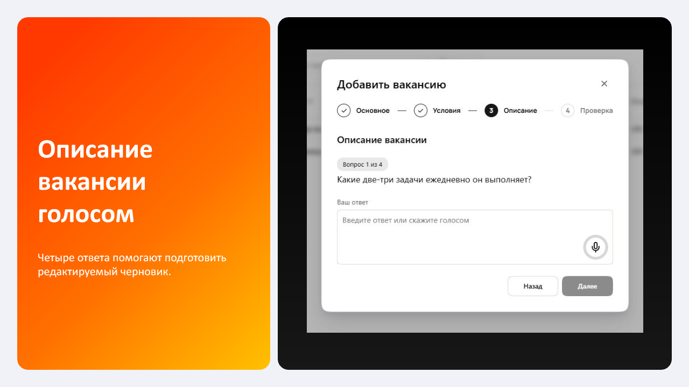
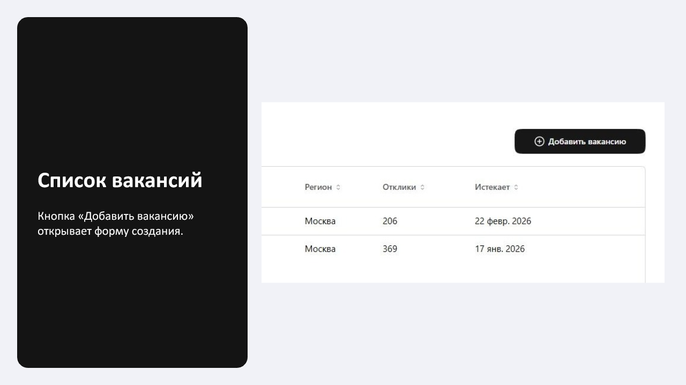
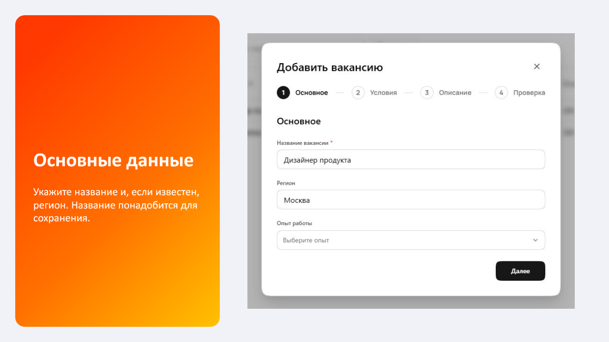
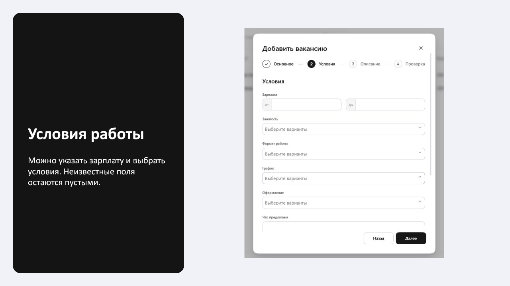
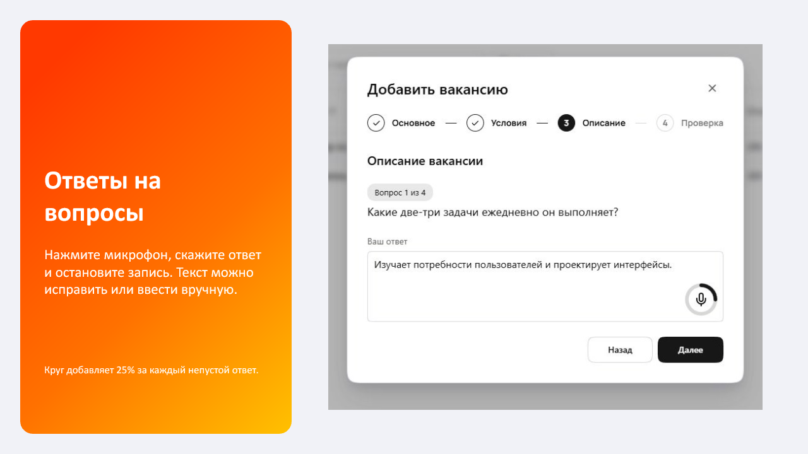
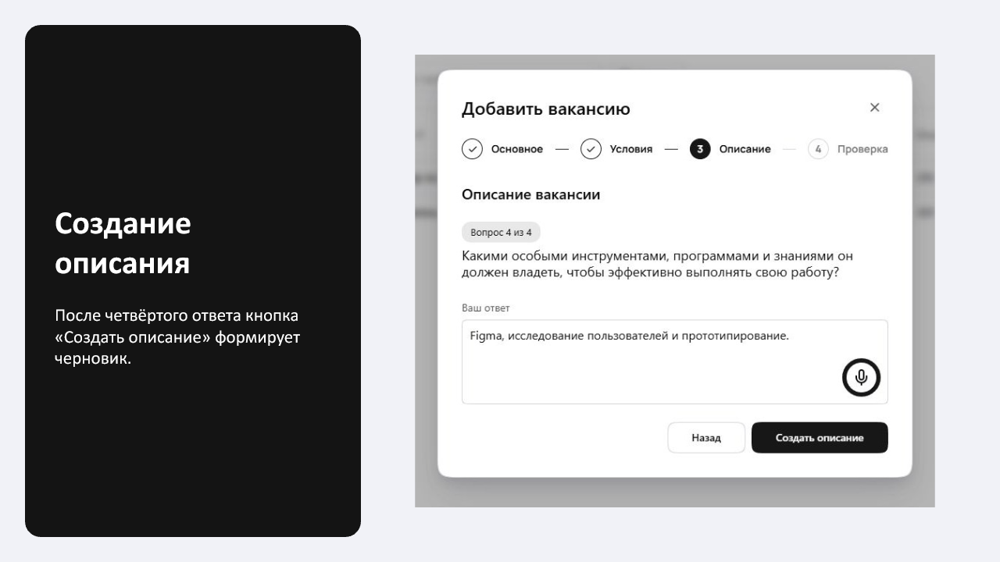
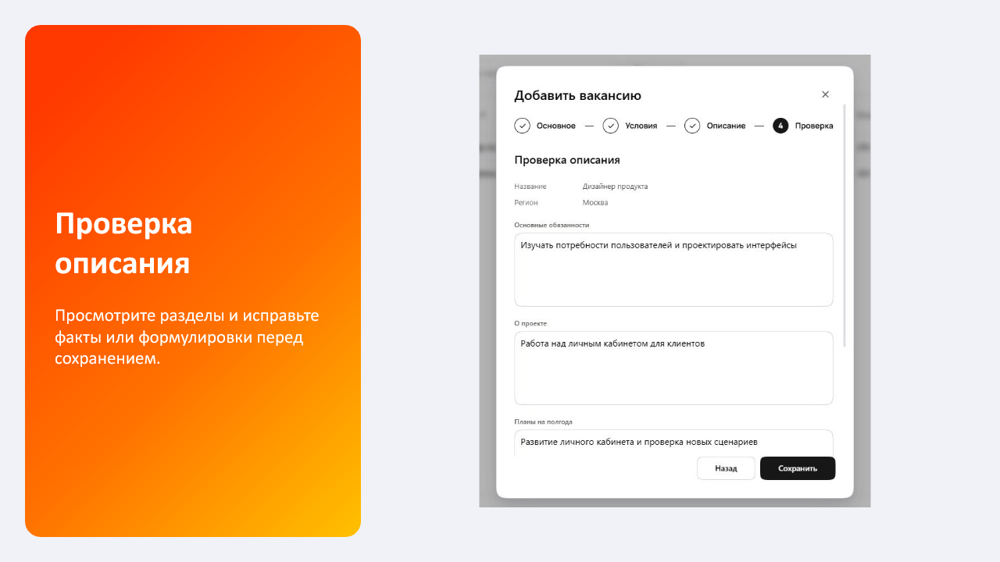
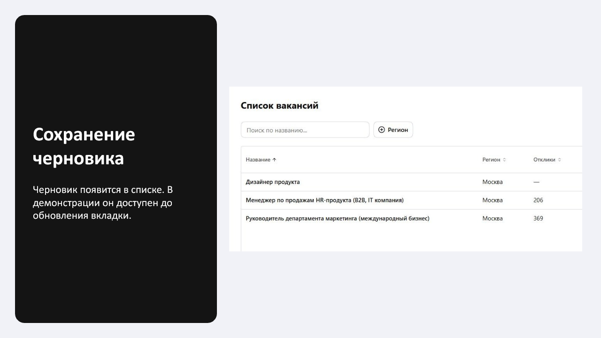

# Создание описания вакансии голосом

[Открыть презентацию в PDF](voice-vacancy-presentation.pdf) · [Скачать презентацию в PowerPoint](voice-vacancy-presentation.pptx) · [Открыть демонстрацию](https://trueakaru-stack.github.io/iskra-vacancy-prototype/)

На экранах использованы вымышленные данные; примеры ответов введены вручную. После остановки записи аудио передаётся сервису обработки. Подключение к голосовому помощнику и хранилищу действующего продукта ещё предстоит. PDF содержит изображения слайдов; текст можно редактировать в файле PowerPoint.

